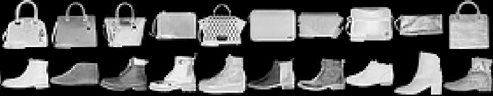

## TODO: Update library check

Add any libraries that are used to the `libs` vector.
If lesson is base R only, remove this chunk entirely.

```{r library-check, echo = FALSE, results = "hide"}
#| output: false

libs <- c("randomForest", "keras3", "dplyr")
libs_missing <- libs[!(libs %in% installed.packages()[, "Package"])]
if (length(libs_missing) > 0) {
  for (l in libs_missing) {
    install.packages(l)
  }
}
```

Neural networks provide a means of making predictions for problems too 
difficult to solve with linear models. In this workshop, we will introduce the 
concept of these models, build an image classification model, and compare the 
predictive power with other machine learning models.

#### Learning objectives

After this lesson, learners should be able to:

1. Install packages necessary to build neural network and random forest models.
2. Split data into testing set and training set.
3. Build a neural network model for classification.
4. Build a random forest model for classification.
5. Compare model performance.

## [DESCRIPTION OR MOTIVATION; 2-4 sentences that would be used for an announcement]

A large field of data science involves identifying what group an observation 
belongs to. This includes things like image categorization. In this workshop we 
will build a neural network to classify images and compare the model's 
performance with a tree-based approach.

## Setup

First we need to setup our development environment. Open RStudio and create a 
new project via:

+ File > New Project...
+ Select 'New Directory'
+ For the Project Type select 'New Project'
+ For Directory name, call it something like "r-stats" (without the quotes)
+ For the subdirectory, select somewhere you will remember (like "My Documents" 
or "Desktop")

We need to create two folders: 'data' will store the data we will be analyzing, 
and 'output' will store the results of our analyses.

```{r setup, eval = FALSE}
dir.create(path = "data")
dir.create(path = "output")
```

***

## Getting started

### Python

Wait, I'm here for an R lesson.

True, but to get the most out of what neural networks can do, we will be 
relying on the Python programming language to do most of the heavy lifting. 
Don't worry - we will not be writing any Python code, R will handle that in the 
background. But we do need to make sure Python is installed on your machine. To 
do so will vary based on your operating system:

#### Windows

1. Press the Windows Key, type `cmd`, and press Enter.
2. Type `where python` and press Enter.

#### MacOS & Linux

1. Open the Terminal app (on Mac, press Cmd + Space and search for "Terminal").
2. Type `which python3` and press Enter.

If Python is installed on your machine, it should print out a path (a series of
folder names) where Python is installed. If _nothing_ prints, then it means 
Python could not be found on your system and you should proceed with installing 
Python. To do so, you can install it from the Python page at
[python.org](https://www.python.org/). There is also a nice step-by-step 
tutorial to help with installation at
[https://sarahstueve.github.io/learn-python/setup.html](https://sarahstueve.github.io/learn-python/setup.html)
(Select "The traditional way" tab and stop before the "Download VSCode" step).

After installation, be sure to double-check the installation worked by 
following the directions above for finding Python on your operating system.

#### Linux extras

For those of you who are using Linux, there are two more packages you need to 
have installed in addition to Python (these are not necessary for the Windows 
and MacOS folks). These are the python3-venv and python3-dev packages. For 
example, on Ubuntu, you can install these via:

```{bash, eval = FALSE}
sudo apt install python3-venv python3-dev
```

I leave it to the readers of other Linux distributions to figure out how to 
install those packages for their OS.

### Install additional R packages

There are _two_ additional R packages that will need to be installed. The 
first package is required for the neural network model, and the second package 
is required for the random forest model:

+ keras3
+ randomForest

To install these, run:

```{r install-libraries, eval = FALSE}
install.packages("keras3")
install.packages("randomForest")
```

### Set up neural network packages

While many packages in R are ready to use once they are installed, our neural 
network package (keras3) needs to check our Python installation to make sure it 
has all the necessary _Python_ packages to run. To get things setup, we will 
need to run a command for R to set up some of this machinery in the background.

```{r setup-keras3}
library(keras3)
op_convert_to_tensor("Hello World!")
```

::: {.callout-tip appearance="true" collapse="true"}
### Error

If these `library()` steps resulted in an error, your machine is not ready for 
the remainder of the lesson. If this is the case, you can look at the 
[documentation for the keras3 package](https://cran.r-project.org/web/packages/keras3/vignettes/getting_started.html) 
to see if you can fix things. If that does not work, I recommend heading to 
Google Colab and starting a new R session there. If you do use Google Colab, 
follow the following steps:

1. Create a new notebook.
2. Make sure you are running an R session by clicking the "Connect" button, 
selecting "Change Runtime Type", and in the "Runtime Type" drop-down menu 
select "R", and click "Save".
3. Create a new code cell at the top of the notebook, paste the following code 
into the block and execute the cell:
```
system("sudo apt-get update && sudo apt-get install -y python3-venv python3-pip python3-dev", wait = TRUE, ignore.stdout = FALSE, ignore.stderr = FALSE)
```
:::

### Download data

The data we are Fashion MNIST data, or "FMNIST". The data are grayscale images, 
where each images shows one of ten different fashion articles (e.g. shirt, 
dress, bag). Each image is 28x28 pixels, with values from 0-255, where 0 is 
pure black and 255 is white. The image below shows 20 examples: 10 images 
classified as "bags" and 10 images classified as "Ankle boots".



The [original dataset](https://github.com/fendy07/FMNIST-DeepLearning) (70,000 
images!) is much larger that we will want to work with today. Instead, we will 
use a much smaller dataset that (1) is a sample of only 7,000 images and (2) 
has already converted the 28x28 images into a format that R can work with (more 
about this later). For now, go ahead and download the file from
[https://bit.ly/fmnist-data](https://bit.ly/fmnist-data) or
[https://raw.githubusercontent.com/jcoliver/learn-r/refs/heads/gh-pages/data/fmnist-subsample.csv](https://raw.githubusercontent.com/jcoliver/learn-r/refs/heads/gh-pages/data/fmnist-subsample.csv) 
(the former just redirects to the latter). You should be able to right-click or
control-click on the link and select "Save As..." to download the file. Make 
sure you download the file to the "data" folder you created earlier (or move 
the file to the "data" folder if your web browser automatically downloads files 
to a specific destination such as your "Downloads" folder).

***

## [TOPIC ZERO]

Data transformation from images to tables

***

## [TOPIC ONE]

```{r nn1, eval = FALSE}
fmnist <- read.csv(file = "data/fmnist-subsample.csv")

# Separate data into testing/training
testing <- fmnist[fmnist$training == 0, ]
training <- fmnist[fmnist$training == 1, ]

# Pull out labels to store separately
testing_labels <- testing$label
training_labels <- training$label

# Pull out data (no label column, no training column)
testing_data <- as.matrix(testing[, -c(1, 786)])
training_data <- as.matrix(training[, -c(1, 786)])

# Look at one of the training images
test_image <- matrix(data = training_data[3, ],
                     nrow = 28, ncol = 28, byrow = TRUE)
plot(as.raster(test_image, max=255))

# Rescale the values from 0 to 255 to 0 to 1
testing_data <- testing_data/255
training_data <- training_data/255

# For the neural network program, we want the labels to be treated as 
# categories, not numbers
# Note: if this is the first call to a keras3 function, might do some 
# downloading here
testing_labels <- to_categorical(x = testing_labels, num_classes = 10)
training_labels <- to_categorical(x = training_labels, num_classes = 10)
```

```{r model-setup}
# Start setting up our model. Here will tell it about the input data - 784 
# columns, one column for each pixel in the image. This is the first layer of 
# our model
model <- keras_model_sequential(input_shape = c(784))

# We add more information about our model, we want one hidden layer that has 32
# nodes and one output layer that has 10 nodes. The 10 output nodes correspond 
# to our labels - that is, what kind of clothing does the image represent
# TODO: Could add a bit more info here, including dropout rate
model |>
  layer_dense(units = 32, activation = 'relu') |>
  layer_dropout(rate = 0.2) |>
  layer_dense(units = 10, activation = 'softmax')

# Look at the model structure, in terms of number of parameters
summary(model)

# Set up some details of how we will fit the model
model |> compile(
  loss = 'categorical_crossentropy',
  optimizer = optimizer_rmsprop(),
  metrics = c('accuracy')
)

# Now we (finally) fit the model and store the history of the model. We provide
#    training_data: the pixel values on a scale of 0-1
#    training_labels: the category of clothing the image represents
#    epochs: how many tries to fine-tune the model
history <- model |> fit(
  training_data, training_labels,
  epochs = 10,
  validation_split = 0.2
)

# Make a nice looking plot of the model fitting process
plot(history)

# Now we use our testing data, that were not used to fit the model, to see how 
# well the model performs on data it has not seen
model |> evaluate(testing_data, testing_labels)

# Calculate, for each image, the probability that it belongs to each of the 
# different categories
probs <- model |> predict(testing_data)

# Use the probabilities and pull out the "best match" for each image
predicted_label <- max.col(probs) - 1L
```

***

## [TOPIC TWO]

```{r nn2, eval = FALSE}
# A model with two hidden layers (one 64, one 32)
model2 <- keras_model_sequential(input_shape = c(784)) |>
  layer_dense(units = 64, activation = 'relu') |>
  layer_dropout(rate = 0.2) |>
  layer_dense(units = 32, activation = 'relu') |>
  layer_dropout(rate = 0.2) |>
  layer_dense(units = 10, activation = 'softmax')

# Size of model
summary(model2)

# Set up some details of how we will fit the model
model2 |> compile(
  loss = 'categorical_crossentropy',
  optimizer = optimizer_rmsprop(),
  metrics = c('accuracy')
)

# Now we (finally) fit the model and store the history of the model. We provide
#    training_data: the pixel values on a scale of 0-1
#    training_labels: the category of clothing the image represents
#    epochs: how many tries to fine-tune the model
history2 <- model2 |> fit(
  training_data, training_labels,
  epochs = 10,
  validation_split = 0.2
)

# Make a nice looking plot of the model fitting process
plot(history2)
```

***

## [TOPIC THREE]

Compare the accuracy of our neural network model to that of a random forest 
model.

***

## Bonus Track: Data Wrangling

### Or, How Did We Get Here?

The data we are working with in this lesson are from a larger dataset of 70,000 
images. The Fashion-MNIST (or FMNIST) dataset includes grayscale images of ten 
different clothing types. All images are 28x28 pixels and available at [https://github.com/zalandoresearch/fashion-mnist](https://github.com/zalandoresearch/fashion-mnist). 
In the following code, you can see how the large dataset of images was 
downloaded, transformed to tabular format, and saved as a CSV file. You do not 
need to run this code for the lesson above, but it is included here for your 
own reference.

The data set is composed of four compressed files:

1. Testing images
2. Testing image labels (i.e. the type of clothing the image represents)
3. Training images
4. Training image labels

To do the procesing, we are going to use two packages, the dplyr package for 
data wrangling and the R.utils package for decompressing the data files. If 
you have not done so already, you can install these packages with:

```{r install-data-libs, eval = FALSE}
install.packages(dplyr)
install.packages(R.utils)
```

After the packages are installed, you can load them into memory:

```{r load-data-libs, eval = FALSE}
library(dplyr)
library(R.utils)
```

#### Testing data

We start with the testing data, doing the download, conversion of image data to 
numeric data, and creating a smaller subset of data for analysis. Note we are 
only going to use 10% of the data so the models will run quickly. We could have 
used all 70,000 images, but it would require more time than we have in this 
workshop.

```{r testing-data, eval = FALSE}
### Retrieval of testing data
# Get testing data labels, start by indicating where they come from (the URL) 
# and where we will store the file locally
testing_labels_url <- "https://github.com/zalandoresearch/fashion-mnist/raw/refs/heads/master/data/fashion/t10k-labels-idx1-ubyte.gz"
testing_labels_file <- "t10k-labels-idx1-ubyte"
testing_labels_gz <- paste0(testing_labels_file, ".gz")

# We use the values stored in those variables to download the archive to our 
# own computer
download.file(url = testing_labels_url,
              destfile = testing_labels_gz)

# We really do need to use readBin twice, as the first time through does some 
# sort of necessary counting.
n <- readBin(con = R.utils::gunzip(testing_labels_gz, 
                                   remove = FALSE,
                                   overwrite = TRUE), 
             what = "integer",
             n = 1, size = 4)
# The second call to readBin actually reads the image data from the binary file
testing_labels <- readBin(con = R.utils::gunzip(testing_labels_gz, 
                                                remove = FALSE,
                                                overwrite = TRUE),
                          what = "integer",
                          n = n, size = 1, signed = FALSE)

# There is something odd about this vector, as we get 10,008 values back, 
# including a pair of integers outside the expected 0-9 range (elements 7 and 8 
# specifically, are too large: 39 and 16, respectively).

# So we drop the first 8 elements from this labels vector
testing_labels <- testing_labels[9:length(testing_labels)]

# Now we can remove the gzip and resultant binary file
invisible(file.remove(testing_labels_gz))
invisible(file.remove(testing_labels_file))

# Get testing data images and convert to a matrix
# Note this code is based on the gist at https://gist.github.com/brendano/39760

# Set up source and destination for images
testing_images_url <- "https://github.com/zalandoresearch/fashion-mnist/raw/refs/heads/master/data/fashion/t10k-images-idx3-ubyte.gz"
testing_images_file <- "t10k-images-idx3-ubyte"
testing_images_gz <- paste0(testing_images_file, ".gz")

# Download test images (file is 4.2 MB, so it might take a moment)
download.file(url = testing_images_url,
              destfile = testing_images_gz)

# We will extract the images and ultimately store them (and some metadata) in 
# this list
images_list <- list()
f <- file(description = R.utils::gunzip(testing_images_gz,
                                        overwrite = TRUE,
                                        remove = FALSE), 
         open = "rb")
# The first readBin does does some required counting
first_read <- readBin(con = f, what = "integer", n = 1, size = 4, endian = "big")
# Count the number of images (there should be 10,000)
images_list$n <- readBin(con = f, what = "integer", n = 1, size = 4, endian = "big")
# In this case, num_row is the number of rows of pixels in an image (should be 28)
num_row <- readBin(con = f, what = "integer", n = 1, size = 4, endian = "big")
# In this case, num_col is the number of rows of pixels in an image (should be 28)
num_col <- readBin(con = f, what = "integer", n = 1, size = 4, endian = "big")
# Here we actually read all the data in, as a single, very, very long vector
images_data <- readBin(con = f, what = "integer", 
                       n = images_list$n * num_row * num_col,
                       size = 1, signed = FALSE)
# We take those data, currently a vector 7,840,000 elements long. We convert it
# to a matrix of 10000 rows and 784 columns
images_list$images_data <- matrix(data = images_data,
                                  ncol = num_row * num_col,
                                  byrow = TRUE)
# Stop reading from the binary file
close(f)

# Now we can remove the gzip and resultant binary file
invisible(file.remove(testing_images_file))
invisible(file.remove(testing_images_gz))

# Data are now stored in images_list$images_data as a matrix with 10000 rows 
# (one row per image), and 784 columns.

# Combine the testing labels and data

# For the purposes of the workshop, we store these data as a matrix with 
# 1 + 784 + 1 columns, where the first column is the label, columns 2-785 are 
# data columns, and columns 786 indicates testing (0) or training (1)
testing_data <- cbind(testing_labels, images_list$images_data)

# Add some more informative column names; the image data, that is pixel values, 
# are in columns prefixed with the letter "p" for "pixel"
colnames(testing_data) <- c("label", paste0("p", 1:(ncol(testing_data) - 1)))

# Create a subsample of data to use as training data (easier to work with in a 
# workshop setting)
# So let us sample down to only 1000 testing images, but making sure we have 
# the same relative sampling for all 10 classes.
testing_data_small <- testing_data %>%
  as_tibble() %>%
  group_by(label) %>%
  slice_sample(n = 100) %>% # pull out 100 of each class
  ungroup() %>%
  sample_n(size = 1000) # shuffle rows again

# Add one more column indicating whether or not these data are to be used for 
# training (for these, no, so set to 0)
testing_data_small$training <- 0

# Clean up testing data debris (we don't need these variables anymore)
rm(testing_labels_url, testing_labels_gz, testing_labels_file, testing_labels,
   testing_images_url, testing_images_gz, testing_images_file, testing_data,
   images_list, images_data, f, first_read, n, num_col, num_row)
```

And we do just about the same thing for the training data. The only big 
difference is that the training data is a larger dataset (60,000 images, as 
opposed to the 10,000 testing images).

```{r training-data, eval = FALSE}
# Get training data labels
training_labels_url <- "https://github.com/zalandoresearch/fashion-mnist/raw/refs/heads/master/data/fashion/train-labels-idx1-ubyte.gz"
training_labels_file <- "train-labels-idx1-ubyte"
training_labels_gz <- paste0(training_labels_file, ".gz")

# Download the training label information
download.file(url = training_labels_url,
              destfile = training_labels_gz)

# We really do need to use readBin twice, as the first time through does some 
# sort of necessary counting.
n <- readBin(con = R.utils::gunzip(training_labels_gz, 
                                   remove = FALSE,
                                   overwrite = TRUE), 
             what = "integer",
             n = 1, size = 4)
training_labels <- readBin(con = R.utils::gunzip(training_labels_gz, 
                                                remove = FALSE,
                                                overwrite = TRUE),
                          what = "integer",
                          n = n, size = 1, signed = FALSE)
# We now have a vector that we have to drop the first 8 elements from
training_labels <- training_labels[9:length(training_labels)]
# Now we can remove the gzip and resultant binary file
invisible(file.remove(training_labels_gz))
invisible(file.remove(training_labels_file))

# Get training data images and convert to a matrix
# Based on the gist at https://gist.github.com/brendano/39760

training_images_url <- "https://github.com/zalandoresearch/fashion-mnist/raw/refs/heads/master/data/fashion/train-images-idx3-ubyte.gz"
training_images_file <- "train-images-idx3-ubyte.gz"
training_images_gz <- paste0(training_images_file, ".gz")

# The file is 25MB, so it might take a few moments to download
download.file(url = training_images_url,
              destfile = training_images_gz)
images_list <- list()
f <- file(description = R.utils::gunzip(training_images_gz,
                                        overwrite = TRUE,
                                        remove = FALSE), 
         open = "rb")
# Run readBin for initial counting of images
first_read <- readBin(con = f, what = "integer", n = 1, size = 4, endian = "big")
# Count the number of images (there should be 60,000)
images_list$n <- readBin(con = f, what = "integer", n = 1, size = 4, endian = "big")
# In this case, num_row is the number of rows of pixels in an image (should be 28)
num_row <- readBin(con = f, what = "integer", n = 1, size = 4, endian = "big")
# In this case, num_col is the number of rows of pixels in an image (should be 28)
num_col <- readBin(con = f, what = "integer", n = 1, size = 4, endian = "big")
# Here we actually read all the data in, as a single vector
images_data <- readBin(con = f, what = "integer", 
                       n = images_list$n * num_row * num_col,
                       size = 1, signed = FALSE)
# We take those data, currently a vector 47,040,000 elements long. We convert 
# it to a matrix of 60000 rows and 784 columns
images_list$images_data <- matrix(data = images_data,
                                  ncol = num_row * num_col,
                                  byrow = TRUE)
# Stop reading from the binary file
close(f)

# Now we can remove the gzip and resultant binary file
invisible(file.remove(training_images_file))
invisible(file.remove(training_images_gz))
# Data are now stored in images_list$images_data as a matrix with 60000 rows 
# (one row per image), and 784 columns.

# Combine labels and data
# Just as we did for testing data, we store these data as a matrix with 
# 1 + 784 + 1 columns, where the first column is the label, columns 2-785 are 
# images data columns, and columns 786 indicates testing (0) or training (1)
training_data <- cbind(training_labels, images_list$images_data)

# Add some more informative column names
colnames(training_data) <- c("label", paste0("p", 1:(ncol(training_data) - 1)))

# Create a subsample of data to use as training data
# So let us sample down to only 6000 testing images, but making sure we have 
# the same relative sampling for all 10 classes.
training_data_small <- training_data %>%
  as_tibble() %>%
  group_by(label) %>%
  slice_sample(n = 600) %>% # pull out 600 of each class
  ungroup() %>%
  sample_n(size = n()) # shuffle rows again

# Add one more column indicating whether or not these data are to be used for 
# training (for these, yes, so set to 1)
training_data_small$training <- 1

# Clean up training data debris
rm(training_labels_url, training_labels_gz, training_labels_file, 
   training_labels, training_images_url, training_images_gz, 
   training_images_file, training_data, images_list, images_data, f, 
   first_read, n, num_col, num_row)

# Combine the testing and training data into a single data.frame (or, more 
# accurately, a tibble)
fmnist_subsample <- testing_data_small %>%
  bind_rows(training_data_small)

# And finally (finally!) save the data as a CSV file
write.csv(file = "data/fmnist-subsample.csv",
          row.names = FALSE,
          x = fmnist_subsample)
```

***

## Additional resources

+ The [getting started vignette](https://cran.r-project.org/web/packages/keras/vignettes/index.html) for the keras3 package, which is used in this lesson.
+ [Neural Networks and Deep Learning](http://neuralnetworksanddeeplearning.com/index.html) 
is a great (and free!) online book about the conceptual underpinnings and 
practical applications of neural networks.
+ A [PDF version](https://jcoliver.github.io/learn-r/lesson-name.pdf) of this lesson

***
